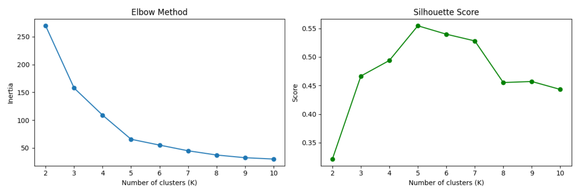
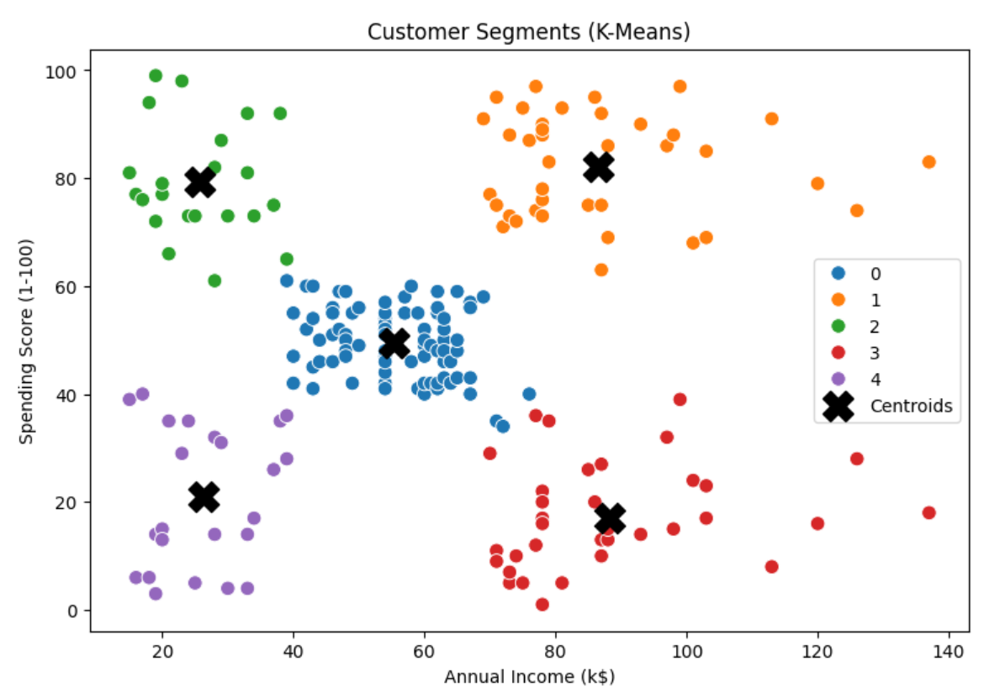
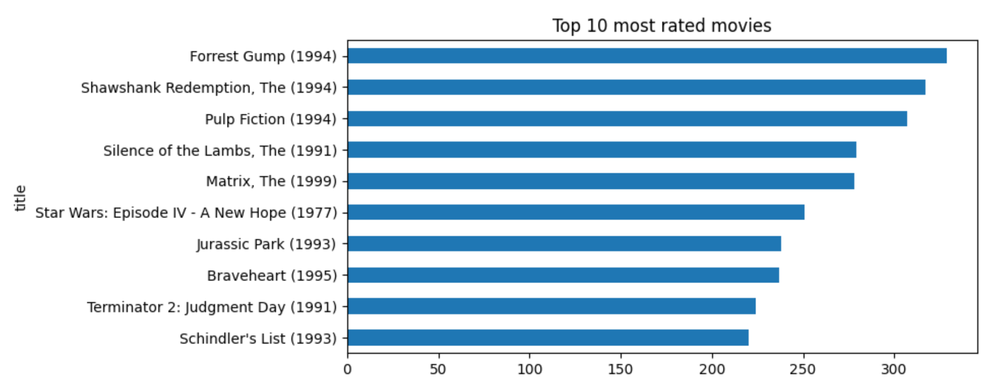
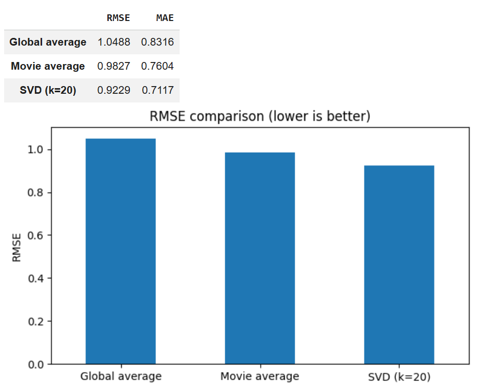
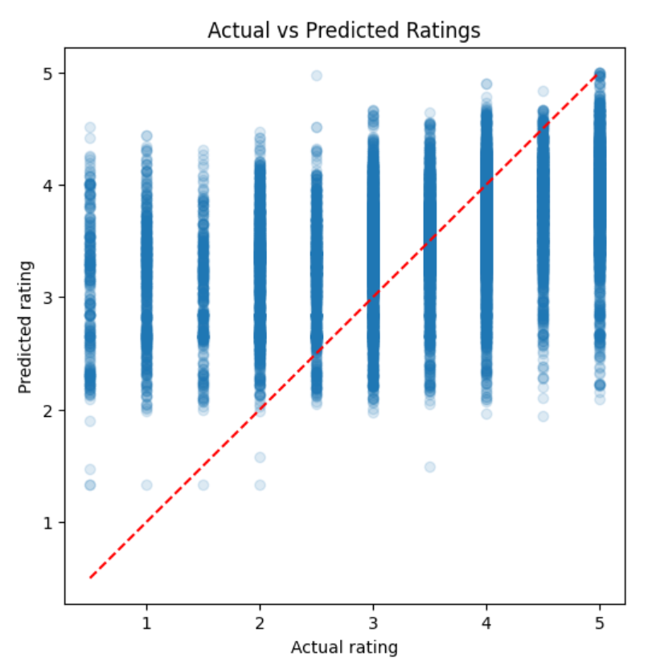

# Data Science Internship: Month 2


This repository contains my Month 2 work for the **Data Science Internship at Arch Technologies**. It includes two machine learning projects: **customer segmentation** with K-Means clustering and **movie rating prediction** with collaborative filtering (SVD). Both projects cover data loading, exploration, pre-processing, modeling, evaluation and interpretation.

(Month 1 work, Titanic classification and stock price prediction, is in a separate repository: [datascience-internship-month1](https://github.com/maheenawan-dev/datascience-internship-month1).)

---

## Table of Contents

- [Projects at a Glance](#projects-at-a-glance)
- [Task 3: Customer Segmentation](#task-3-customer-segmentation)
- [Task 4: Movie Rating Prediction](#task-4-movie-rating-prediction)
- [Tools and Technologies](#tools-and-technologies)
- [Repository Structure](#repository-structure)
- [How to Run](#how-to-run)
- [Key Learnings](#key-learnings)
- [Limitations and Future Work](#limitations-and-future-work)
- [Author](#author)

---

## Projects at a Glance

| | Task 3: Customer Segmentation | Task 4: Movie Rating Prediction |
|---|---|---|
| **Problem type** | Unsupervised learning (clustering) | Regression (collaborative filtering) |
| **Goal** | Group customers by purchasing behaviour | Predict the rating a user would give to an unseen movie |
| **Data** | Kaggle Mall Customer Segmentation Data (200 customers) | MovieLens ml-latest-small (100,836 ratings, 610 users, 9,724 movies) |
| **Method** | K-Means (K = 5) | SVD matrix factorization (k = 10) |
| **Best result** | **Silhouette score = 0.5547** | **RMSE = 0.9210**, MAE = 0.7104 |
| **Notebook** | `Task3_Customer_Segmentation.ipynb` | `Task4_Movie_Rating.ipynb` |

---

## Task 3: Customer Segmentation

**Objective:** Divide mall customers into groups with similar behaviour so that marketing can be targeted better.

### Dataset
The "Mall Customer Segmentation Data" file (`Mall_Customers.csv`) from Kaggle: 200 customers with Gender, Age, Annual Income (k$) and Spending Score (1-100). There are no missing values.

### Workflow
1. **Load and explore** the data (`head`, `info`, `describe`, missing values).
2. **Exploratory data analysis:** histograms of Age, Income and Spending Score, a gender count plot and an Income vs Spending scatter plot.
3. **Pre-process:** drop `CustomerID`, rename columns, select **Income** and **Spending Score** as features and scale them with `StandardScaler`.
4. **Choose K** using the elbow method and the silhouette score (K = 2 to 10). Both point to **K = 5**.
5. **Train K-Means** (`random_state=42`, `n_init=10`).
6. **Visualize** the clusters and centroids.
7. **Profile each segment** (size, average age, income, spending and gender share).
8. **Extra experiment:** adding Age as a third feature lowered the silhouette score from 0.5547 to 0.4166.



### Results

| Cluster | Customers | Avg. Age | Avg. Income (k$) | Avg. Spending | Segment |
|---|---|---|---|---|---|
| 0 | 81 | 42.7 | 55.3 | 49.5 | Average customers |
| 1 | 39 | 32.7 | 86.5 | 82.1 | High income, high spending |
| 2 | 22 | 25.3 | 25.7 | 79.4 | Low income, high spending |
| 3 | 35 | 41.1 | 88.2 | 17.1 | High income, low spending |
| 4 | 23 | 45.2 | 26.3 | 20.9 | Low income, low spending |



### Key Findings and Suggestions
- **High income, high spending:** the best customers. Loyalty programs and premium offers can keep them.
- **High income, low spending:** can afford more but spend little. Personalised promotions could increase their spending.
- **Low income, high spending:** young customers who spend a lot. Discounts and installment offers suit them.
- **Average customers:** the largest group. Regular offers and seasonal sales are enough.
- **Low income, low spending:** the lowest priority group. Low-cost marketing is enough.

---

## Task 4: Movie Rating Prediction

**Objective:** Predict how a user would rate a movie they have not seen yet.

### Dataset
The MovieLens **ml-latest-small** dataset from GroupLens: `ratings.csv` (100,836 ratings from 610 users on 9,724 movies, scale 0.5 to 5.0) and `movies.csv`. The notebook downloads it automatically, so it is not stored in this repository.

### Workflow
1. **Download, load and explore** the data. There are no missing values.
2. **Merge** ratings with movie titles and run EDA: rating distribution, ratings per user, ratings per movie and the top 10 most rated movies.
3. **Split** the data 80/20 (80,668 training and 20,168 test ratings, `random_state=42`).
4. **Baselines:** global average rating and movie average rating.
5. **Collaborative filtering with SVD:** mean-center the ratings by user, build a sparse user-movie matrix and factorize it with `TruncatedSVD`. Predictions are clipped to the range 0.5 to 5.0.
6. **Tune** the number of factors k (5, 10, 20, 50). The best was **k = 10**.
7. **Evaluate** with RMSE and MAE, and compare with the baselines.



### Results

| k | RMSE | MAE |
|---|---|---|
| 5 | 0.9219 | 0.7117 |
| **10** | **0.9210** | **0.7104** |
| 20 | 0.9229 | 0.7117 |
| 50 | 0.9320 | 0.7193 |

| Model | RMSE | MAE |
|---|---|---|
| Global average | 1.0488 | 0.8316 |
| Movie average | 0.9827 | 0.7604 |
| **SVD (k = 10)** | **0.9210** | **0.7104** |



SVD lowered the RMSE by about **12%** compared with the global average and about **6%** compared with the movie average.



### Key Findings
- Most ratings fall between 3.0 and 5.0, and 4.0 is the most common rating.
- The rating matrix is very sparse: only about 1.7% of all user-movie pairs have a rating.
- The model predicts mostly between 2 and 4.5, so it works better for typical ratings than for extreme ones.

---

## Tools and Technologies

- **Language:** Python
- **Environment:** Google Colab
- **Data handling:** pandas, NumPy, SciPy (sparse matrices)
- **Visualization:** matplotlib, seaborn
- **Machine learning:** scikit-learn (KMeans, StandardScaler, TruncatedSVD, metrics)
- **Data sources:** Kaggle, GroupLens (MovieLens)
- **Version control:** Git and GitHub

---

## Repository Structure

```
datascience-internship-month2/
├── Task3_Customer_Segmentation.ipynb   # K-Means customer segmentation
├── Task4_Movie_Rating.ipynb            # SVD movie rating prediction
├── Mall_Customers.csv                  # Customer dataset (from Kaggle)
├── images/                             # Result screenshots used in this README
│   ├── elbow_silhouette.png
│   ├── customer_segments.png
│   ├── top10_movies.png
│   ├── rmse_comparison.png
│   └── actual_vs_predicted.png
└── README.md                           # Project documentation
```

---

## How to Run

### Option 1: Google Colab (recommended)
1. Open [Google Colab](https://colab.research.google.com) and choose **File → Upload notebook**.
2. Upload `Task3_Customer_Segmentation.ipynb` or `Task4_Movie_Rating.ipynb`.
3. For **Task 3**, upload `Mall_Customers.csv` using the Files panel on the left.
4. Run all cells with **Runtime → Run all**. Task 4 downloads MovieLens by itself.

### Option 2: Run locally
```bash
# 1. Clone the repository
git clone https://github.com/maheenawan-dev/datascience-internship-month2.git
cd datascience-internship-month2

# 2. Install the required libraries
pip install pandas numpy scipy matplotlib seaborn scikit-learn jupyter

# 3. Start Jupyter and open a notebook
jupyter notebook
```

> **Note:** In Task 4 the cells that start with `!wget` and `!unzip` are Colab/Linux commands. On Windows, download `ml-latest-small.zip` from [GroupLens](https://grouplens.org/datasets/movielens/latest/) and extract it next to the notebook.

---

## Key Learnings

- Choosing the number of clusters with the elbow method and the silhouette score.
- Scaling features before using a distance-based algorithm such as K-Means.
- Turning clusters into business segments with clear names and marketing ideas.
- Working with sparse user-item data and mean-centering ratings.
- Comparing a model with simple baselines using RMSE and MAE.
- Tuning a model setting (k) and choosing it by the lowest error on the test set.

---

## Limitations and Future Work

- **Customer segmentation:** the dataset is small (200 customers) and has few features. More features (purchase history) and other methods (hierarchical clustering, DBSCAN) could be tried.
- **Movie ratings:** the model cannot handle new users or new movies with no ratings (the cold start problem). Genres could be added as features, and SVD++ or neural collaborative filtering could be tested.
- The rating model was tuned on the test set; a separate validation set or cross-validation would give a more reliable estimate.

---

## Author

**Maheen Irfan**
BS Information Technology student, Data Science Intern at Arch Technologies

- GitHub: [@maheenawan-dev](https://github.com/maheenawan-dev)
- LinkedIn: [Maheen Irfan](https://www.linkedin.com/in/maheen-irfan-332353405)

---

*Made as part of the Month 2 tasks of the Data Science Internship at Arch Technologies.*
